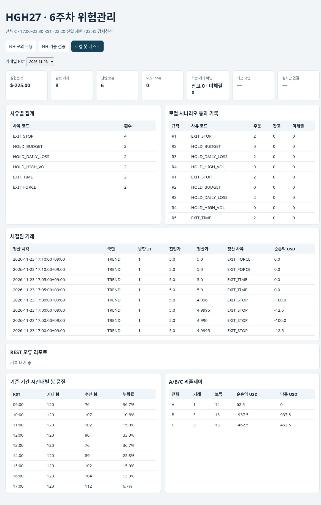

# 6주차 · 주문과 위험관리 — COMEX 구리선물(HGH27) 모의 운용

## 한눈에 보기

COMEX 구리선물 2027년 3월물 `HGH27`에 5주차의 국면 적응형 전략 C를 적용합니다. NH 해외선물 모의계좌에서 1계약씩 운용하며, 진입 보류·청산 사유와 주문·체결·잔고를 기록합니다.

- **위험관리** — 개별 손절, 거래당 손실 예산, 일일 손실 한도, 고변동성 진입 차단, 보유 시간 제한, 강제청산을 적용합니다.
- **검증** — 로컬 봇 테스트로 R1–R6을 재현하고, 별도 기간의 확정 5분봉으로 A/B/C 전략을 비교합니다.
- **연결 개선** — 모의 운용의 REST 기본 타임아웃을 20초로 늘렸습니다. WebSocket은 시세 무수신 중에도 연결을 유지합니다.

[6주차 과제 명세](https://app.notion.com/p/6-421fe264da4d802eb7faf17434b57e58) · [5주차 전략과 종목 선정 근거](../week05/README.md) · [대시보드 캡처](screenshots/dashboard_bot_test.jpg)

## 목차

- [폴더 구성](#폴더-구성)
- [1. 과제 요약](#1-과제-요약)
- [2. 실행 방법](#2-실행-방법)
- [3. 전략과 매매 계획](#3-전략과-매매-계획)
- [4. 사용 API와 프로그램 구조](#4-사용-api와-프로그램-구조)
- [5. 실행 환경](#5-실행-환경)
- [6. 실행 결과](#6-실행-결과)
- [7. 결과 해석과 한계](#7-결과-해석과-한계)
- [8. 오류 대응과 개선사항](#8-오류-대응과-개선사항)
- [9. 향후 계획](#9-향후-계획)

## 폴더 구성

| 경로 | 내용 |
| --- | --- |
| [main.py](main.py) | 시세 점검·수집, 기준값 산출, 리플레이·모의 운용·대시보드 명령 |
| [copper/](copper/) | 시세·주문, 전략·위험관리, 리플레이·결과 집계 |
| [tests/](tests/) | 위험관리와 REST·WebSocket 연결 테스트 |
| [results/](results/) | 기준 데이터, 리플레이 및 운용 기록 |
| [screenshots/](screenshots/) | 로컬 봇 테스트 대시보드 캡처 |
| [pyproject.toml](pyproject.toml) | Python 버전과 의존성 |

## 1. 과제 요약

| 항목 | 이번 구현 | 확인 상태 |
| --- | --- | --- |
| 대상 상품 | COMEX 표준 구리선물 `HGH27` 1계약, 1틱 $12.50 | 5주차와 같은 종목 |
| 전략 | 국면 적응형 C와 위험 규칙 R1–R6 | 로컬 시나리오 6개 통과 |
| 기준 기간 | 2026-11-09~20 확정 5분봉 | 임계값과 손실 예산 확정 |
| 검증 기간 | 2026-11-23~27 확정 5분봉 | 저장된 리플레이는 11/23~24 자료 사용 |
| 모의 운용 | WebSocket 시세, REST 주문·계좌 대사 | 저장소에 11/24 청산 거래 1건 기록 |

## 2. 실행 방법

저장소 루트에서 실행합니다. Python 3.11+와 uv가 필요합니다.

```bash
cd week06
uv sync
uv run pytest
uv run python main.py bot-test
cp .env.example .env
```

`.env`에 NH가 발급한 해외선물 **모의** APP Key와 APP Secret을 입력합니다. 변수명은 `NH_PAPER_OVERSEAS_APP_KEY`, `NH_PAPER_OVERSEAS_APP_SECRET`이다.

1. `inspect`에서 같은 시각의 1분봉·5분봉 OHLC를 대조해 5분봉 라벨이 시작(`start`)인지 종료(`end`)인지 확인합니다.
2. 아래에서 `STAMP`를 확인한 값으로 바꿉니다. `collect`는 2026-11-09~20의 확정 5분봉과 09:00–23:59 KST 시간대별 누락률을 기록합니다. 기준 기간 평일이 통째로 비어 있으면 산출을 중단합니다.
3. `calibrate`는 ER 30·70분위수, 시간대별 ATR 중앙값 대비 상대 ATR 90분위수를 확정합니다. 거래 예산은 손절액 80분위수에 왕복 비용을 더해 $5 단위로 올립니다. 일일 한도는 거래당 예산의 3배입니다. 비용 기본값은 5주차와 같은 편도 1틱, 수수료 $0 가정입니다. 계좌 수수료를 알고 있으면 처음 산출할 때 `--fee-per-side`로 지정합니다.

```bash
uv run python main.py inspect --date 2026-11-20
uv run python main.py collect --bar-stamp STAMP
uv run python main.py calibrate
```

`results/thresholds.json`에 확정 시각과 기준값이 기록됩니다. 운용 기간 중에는 같은 파일을 사용합니다.

### NH 모의계좌 기능 검증

대상 종목의 잔고·미체결이 0인 상태에서 한 번에 시나리오 하나씩 실행합니다. 각 실행은 정상 신호가 발생할 때 위험 규칙을 검증합니다. 로컬 봇 테스트는 고정 신호와 가상 시계로 R1–R6을 재현합니다.

```bash
uv run python main.py paper --bar-stamp STAMP --function-test R1
# R2–R5는 위 명령의 R1을 해당 번호로 바꿔 각각 실행
uv run python main.py paper --bar-stamp STAMP --function-test R6 --force-at 17:50
```

R6 시각은 실행 시각보다 늦고 22:45 이하여야 합니다. R1은 손절 1틱, R2는 예산 $1, R3은 일일 한도 $10, R4는 RV 상한 0, R5는 보유 5분으로 검증합니다. 각 시나리오는 `results/function-test/`에 기록됩니다. 같은 계좌에서 운용으로 전환할 때 잔고·미체결 0을 확인합니다.

### 기준값으로 모의 운용 및 결과 확인

```bash
uv run python main.py paper --bar-stamp STAMP
# 별도 터미널에서 실행하고 브라우저에서 http://127.0.0.1:8606 열기
uv run python main.py dashboard
# 현재까지 확보된 검증 기간 확정봉으로 A/B/C 비교
uv run python main.py replay
```

`replay`는 11월 23~27일 검증 기간의 확정 5분봉을 사용합니다. 로컬에 검증 봉이 없으면 `.env`의 NH 모의계좌 설정으로 확정된 봉을 조회합니다. 조회에는 HGH27에서 확인한 시작 시각 라벨(`--bar-stamp start`)을 기본으로 사용합니다. 일부 날짜만 확보된 시점에는 출력에 표시된 봉 범위까지만 비교합니다. 저장된 검증 봉을 최신으로 갱신하거나 전체 기간 데이터를 보관하려면 `collect --bar-stamp start --last 2026-11-27`을 실행한 뒤 다시 리플레이한다.

운용 로그는 `results/paper/`에 저장합니다. 대시보드에서 모의 운용·NH 기능 검증·로컬 봇 테스트를 선택해 거래일, 순손익, 사유별 보류, 체결, 계좌 확인, REST 오류, 봉 누락률, A/B/C 비교를 확인할 수 있습니다.

## 3. 전략과 매매 계획

추세에서는 EMA(9·21), 횡보에서는 Z-score ±1.5를 사용합니다. 상대 ATR과 ER로 고변동성 → 추세 → 횡보 → 중립 순으로 판정합니다. 고변동성·중립에서는 관망하고, 진입에 사용한 규칙으로 전략 청산을 판정합니다. 5주차의 일일 최대 5회 진입을 유지합니다.

| 규칙 | 기준 | 기록 |
| --- | --- | --- |
| R1 개별 손절 | 신호 봉 ATR × 1.5와 8틱 중 큰 값. 틱 단위 올림 | `EXIT_STOP` |
| R2 손실 예산 | 예상 손절 금액 + 왕복 비용이 거래당 예산을 초과하면 보류 | `HOLD_BUDGET` |
| R3 일일 손실 한도 | 당일 누적 순실현손익이 일일 손실 한도에 도달하면 신규 진입 중단 | `HOLD_DAILY_LOSS` |
| R4 고변동성 | 상대 ATR ≥ RV 상한에서 진입 차단 | `HOLD_HIGH_VOL` |
| R5 보유 시간 | 체결 시각부터 60분 | `EXIT_TIME` |
| R6 강제청산 | 22:45 KST부터 잔여 포지션 시장가 청산 | `EXIT_FORCE` |

운영시간은 평일 **17:00–23:30 KST**입니다. **22:20부터 신규 진입을 막고, 22:45에 강제청산**합니다. 조기 실행 시 지표와 호가를 준비하며 신규 주문은 17:00부터 허용합니다. 22:45 이후에는 포지션 유무와 관계없이 23:30까지 상태를 기록합니다. 추수감사절 기간은 거래 전 CME Globex 상품별 시간을 확인합니다. [CME 휴일 거래시간](https://www.cmegroup.com/trading-hours.html)

## 4. 사용 API와 프로그램 구조

| 방식 | 용도 |
| --- | --- |
| NH WebSocket | 해외 실시간 호가(FB)와 체결 시세(FA) |
| NH REST | 종목코드 확인, 5분봉, 주문가능수량, 시장가 주문, 주문내역·체결, 잔고·미체결 조회 |

| 모듈 | 역할 |
| --- | --- |
| [main.py](main.py) · [market.py](copper/market.py) | 명령 실행, REST 시세 조회와 확정봉 수집 |
| [strategy.py](copper/strategy.py) · [replay.py](copper/replay.py) | 지표·국면·신호 계산, 위험 규칙과 과거 데이터 검증 |
| [live.py](copper/live.py) | 실시간 시세, 모의 주문·체결·계좌 대사 |
| [bot_test.py](copper/bot_test.py) | 가상 시계와 고정 신호로 위험관리 시나리오 재현 |
| [results.py](copper/results.py) · [dashboard.py](copper/dashboard.py) | 결과 저장, 운용 저널과 리플레이 대시보드 |

## 5. 실행 환경

| 항목 | 설정 |
| --- | --- |
| 런타임 | Python 3.11 이상, `uv` |
| 주요 의존성 | `httpx`, `websockets`, `PyYAML`, `truststore`, `tzdata` |
| 시각 | KST(Asia/Seoul), 확정 5분봉 |
| 계좌 | NH 해외선물 모의계좌 |
| 대시보드 | 로컬 운용 로그를 읽고 10초마다 갱신 |

## 6. 실행 결과

### 6-1. 확정 기준값과 시간대별 봉 누락

| 확정 시각 KST | ER 하한 | ER 상한 | RV 상한 | 거래당 예산 USD | 일일 한도 USD |
| --- | --- | --- | --- | --- | --- |
| 2026-11-23 17:15:11 | 0.094639 | 0.266216 | 1.808650 | 400 | 1,200 |

11/09–20 기준 기간에서 NH REST 확정 5분봉 2,331개를 수집했습니다. 1분봉 5개가 모두 있는 71개 구간의 OHLC가 5분봉과 일치해 `--bar-stamp start`를 적용했습니다. 평일 09:00–17:00의 봉 누락률은 23.3%(224/960), 17:00–23:00은 6.7%(48/720)였습니다. 시간대별 결과는 [수집 기록](results/raw/results.json)에 있습니다.

### 6-2. 위험관리 기능 검증

| 규칙 | 로컬 봇 테스트 | NH 모의 운용 기록에서 확인한 동작 |
| --- | --- | --- |
| R1 개별 손절 | 통과 | — |
| R2 손실 예산 | 통과 | — |
| R3 일일 손실 한도 | 통과 | — |
| R4 고변동성 | 통과 | 11/24 고변동성 진입 보류 2건 |
| R5 보유 시간 | 통과 | 11/24 시간 청산 1건 |
| R6 강제청산 | 통과 | — |

NH 모의계좌의 R1–R6 개별 기능 검증은 2절의 명령으로 실행합니다.

### 6-3. A/B/C 리플레이 비교

저장된 11/23~24 확정봉 기준입니다. 수수료 $0과 편도 슬리피지 1틱을 가정했습니다.

| 전략 | 거래 수 | 순손익 USD | 최대 낙폭 USD |
| --- | ---: | ---: | ---: |
| A | 1 | +62.50 | 0.00 |
| B | 3 | −937.50 | 937.50 |
| C | 3 | −462.50 | 462.50 |

[리플레이 결과 JSON](results/replay/results.json)

### 6-4. 일별 모의 운용

저장소에 커밋된 모의 운용 기록을 집계했습니다.

| 날짜 | 거래 수 | 순손익 USD | 사유별 보류 | 청산 규칙 | 종료 잔고·미체결 |
| --- | ---: | ---: | --- | --- | --- |
| 2026-11-23 | 0 | 0.00 | 0건 | — | 종료 대사 기록 없음 |
| 2026-11-24 | 1 | +962.50 | 고변동성 2건 | 보유 시간 | 0계약 · 0건 |
| 2026-11-25 | 0 | 0.00 | 진입 시간 2건, 시세 지연 1건 | — | 0계약 · 0건 |

[11/23 운용 기록](results/paper/20261123_171532_636331/journal_20261123.jsonl) · [11/24 운용 기록](results/paper/20261124_172313_712182/journal_20261124.jsonl) · [11/25 운용 기록](results/paper/20261125_152350_988932/journal_20261125.jsonl)

### 6-5. 대시보드 화면

로컬 봇 테스트 화면입니다. 저장된 두 실행의 R1–R6 검증과 청산·보류 사유를 보여 줍니다. 화면 상단의 손익과 거래 수는 두 로컬 실행의 합계입니다.



## 7. 결과 해석과 한계

- 저장된 2일 리플레이에서 C의 손실과 최대 낙폭은 B보다 작았고, A만 수익을 냈습니다. 거래 수가 전략별 1~3건이어서 기간을 늘려 비교해야 합니다.
- 11/24 모의 운용에서는 고변동성에 따른 진입 보류와 보유 시간에 따른 청산을 확인했습니다. R1–R6의 전체 동작은 로컬 테스트에서 검증했습니다.
- 기준 기간에는 시간대별로 5분봉 누락률이 달랐습니다. 리플레이의 OHLCV 체결 가정과 모의 운용의 실시간 호가·체결은 6절에서 각각 확인할 수 있습니다.

## 8. 오류 대응과 개선사항

`paper`의 REST 요청 타임아웃 기본값을 10초에서 **20초**로 늘렸습니다. 시세·계좌·주문 조회와 주문 전송, WebSocket 접속 키 발급에 같은 REST 클라이언트 설정을 사용합니다. `--rest-timeout`에 0보다 큰 초 단위 값을 지정해 변경할 수 있습니다.

```bash
uv run python main.py paper --bar-stamp start --rest-timeout 30
```

### WebSocket 연결 유지와 종료

- 세션이 초기화되면 시세 메시지가 한동안 없어도 연결을 유지합니다. NH가 애플리케이션 메시지 `pingpong`을 보내면 빈 문자열로 응답합니다.
- 서버나 네트워크가 연결을 끊으면 대기 후 새 접속 키를 받아 재접속하고 FA·FB를 다시 구독합니다. 운용을 정상 종료하면 활성 연결에서 FA·FB 구독을 해제한 뒤 연결을 닫습니다.
- 연결 오류는 운용 저널의 `WS_STATUS`에 오류 유형과 누적 접속 시도 번호를 기록합니다. 접속 키, 토큰, 예외 원문은 기록에서 제외합니다.
- 연결이 유지되는 중에도 호가 또는 체결 시세가 10초 이상 갱신되지 않거나 호가 스프레드가 3틱을 넘으면 진입을 보류합니다.

### 주문 오류와 계좌 대사

주문 요청·접수·체결을 각각 기록하고, 체결 뒤 대상 월물 잔고와 미체결을 대사합니다. 거부 또는 결과 불명 시 재주문 없이 중단합니다. 실행 폴더의 `api-errors.jsonl`에는 REST 연결 오류의 유형과 시도 번호, 주문 거부 코드와 응답 등 오류에 해당하는 진단과 대응을 기록합니다. 구조화된 계좌·인증 정보 필드는 마스킹합니다. `.paper.lock`이 남았다면 실행 중인 봇이 없는지와 NH 주문·체결·잔고를 확인합니다. 미체결 및 잔고 대사가 끝난 뒤 잠금 파일을 치웁니다.

## 9. 향후 계획

| 항목 | 다음에 확인할 내용 |
| --- | --- |
| 리플레이 | 검증 기간 전체 자료를 확보하고 같은 기준값으로 A/B/C 성과 재집계 |
| 위험관리 | NH 모의계좌에서 개별 기능 검증을 실행하고 주문·체결·종료 대사 기록 확보 |
| 연결 | 장시간 모의 운용에서 WebSocket 재접속과 REST 타임아웃 발생 빈도 확인 |
